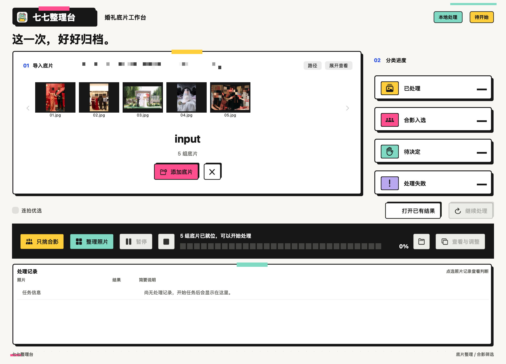
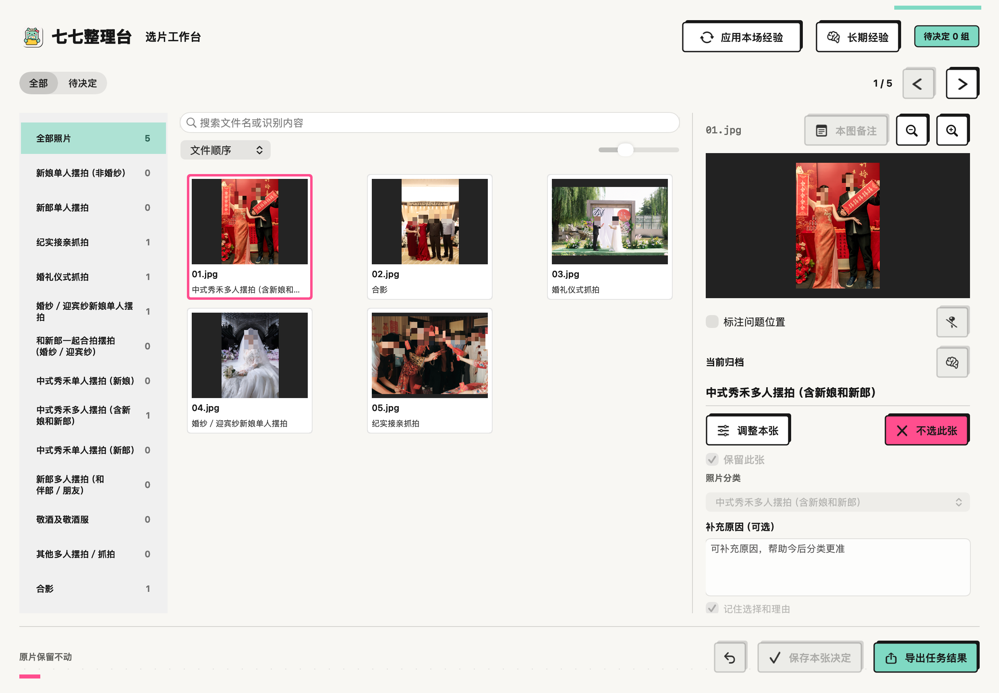
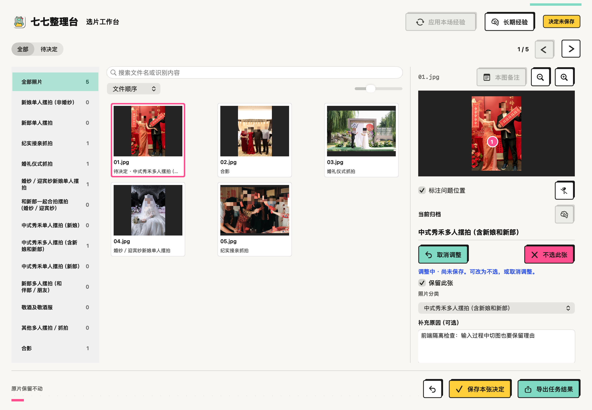
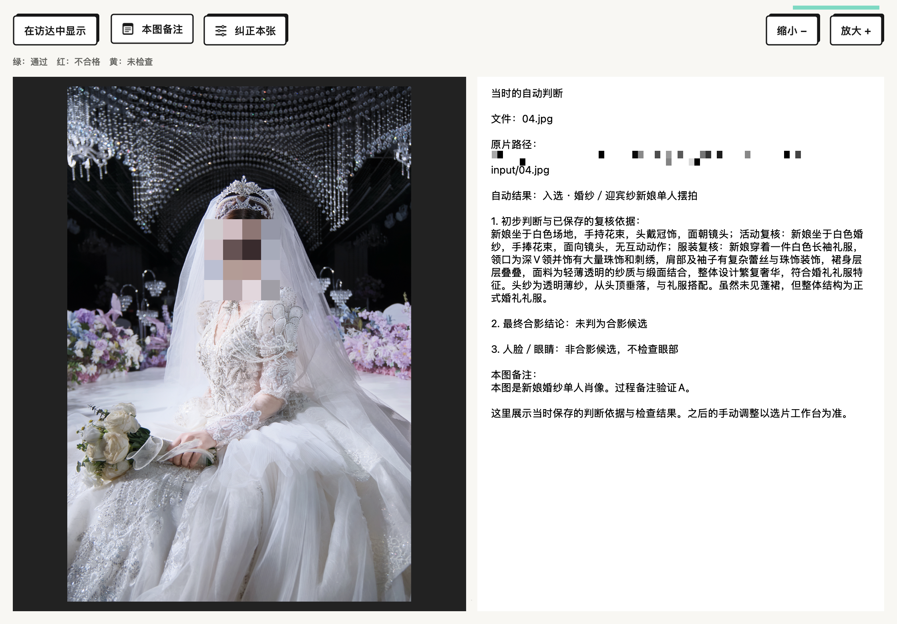
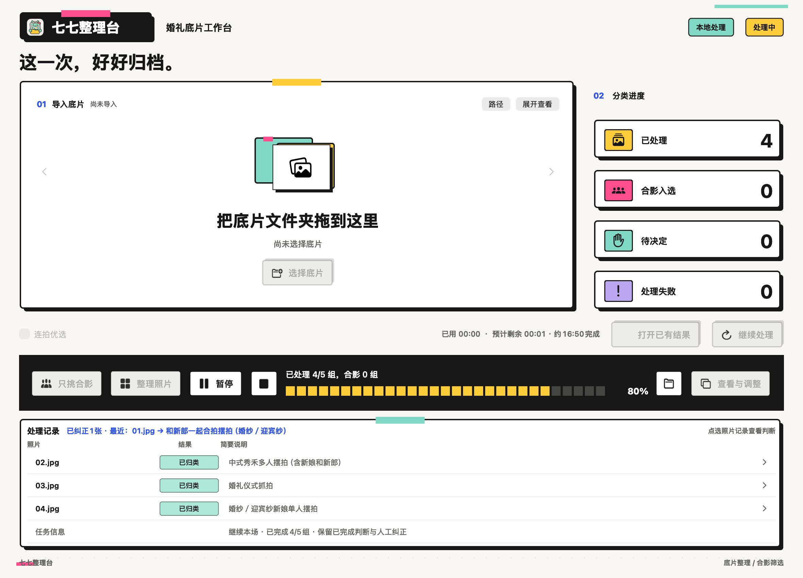
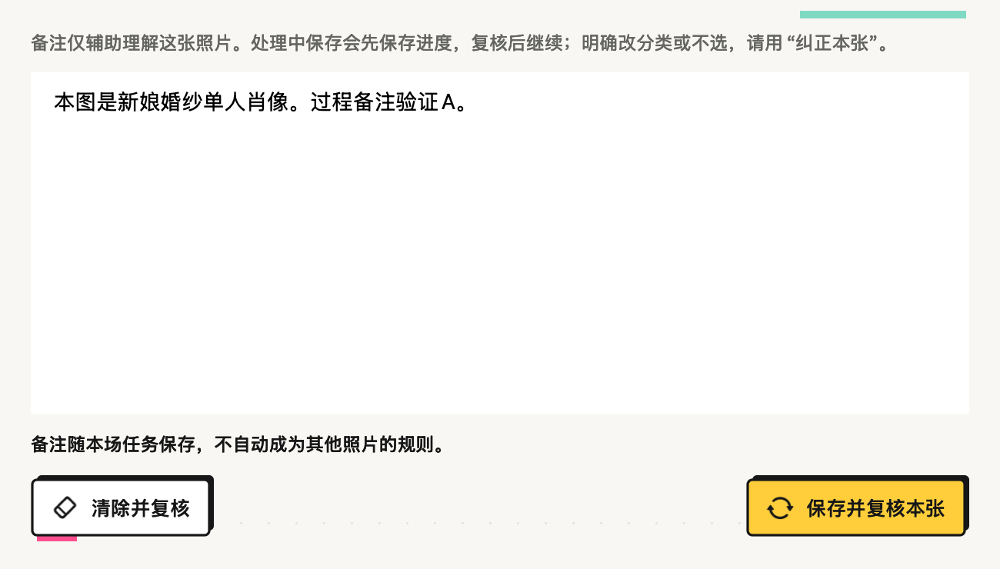
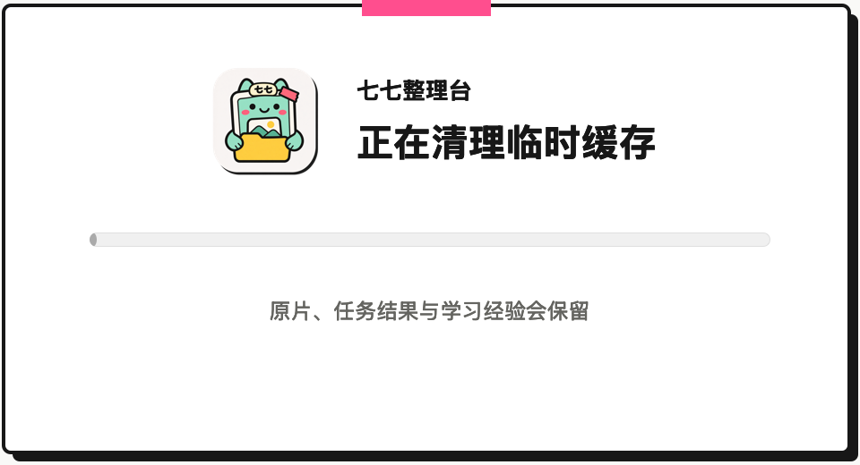
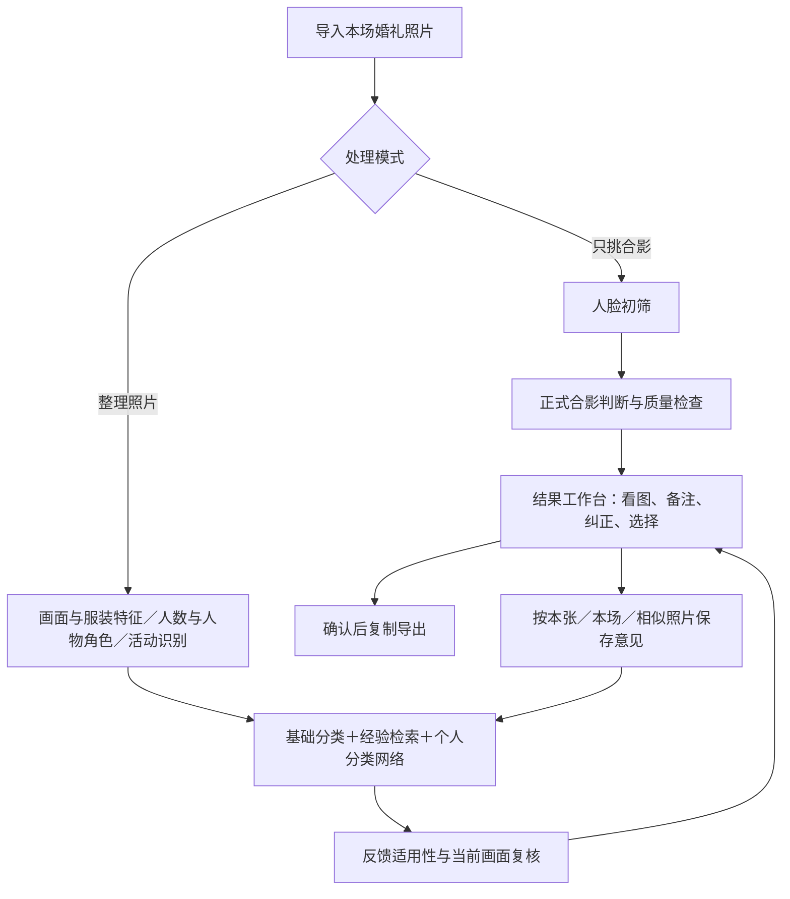

**由摄影师七七与李A联合构建，始于真实的婚礼理片需求。**


# 七七理片 · QiqiSort

**拍完婚礼，别再被理片困住。**

懂婚礼，也记得你的分类习惯。


[**下载七七理片研究版 · Apple 芯片 Mac**](https://github.com/limusu2333/QiqiSort/releases/latest/download/QiqiSort-Research-macOS.zip) · [使用说明](docs/下载与启动.md)

> **仅供学习研究与技术讨论，禁止商业软件开发及商业产品／服务使用。** 本项目公开源码和可运行研究版，希望为摄影师社区提供交流与研究材料。当前 MobileCLIP2 模型官方许可仅限非商业科学研究及学术开发，明确排除商业经营、产品开发及商业产品／服务中的使用；免费提供也不改变该限制。详见 [使用范围与第三方许可](docs/发布范围.md)。

一场婚礼，数千张照片。晨袍、秀禾、婚纱、接亲、仪式、亲友合影……拍摄结束后，还有一轮漫长的整理：逐张看、反复分、找合影，再把照片放进对应的文件夹。

七七理片想替摄影师接过这轮重复劳动。它是一款面向婚礼摄影工作流的**本地 AI 理片助手**，把照片分类、合影筛选、人工复核和个人偏好学习放进同一个工作台。先让七七整理，再由你确认，把精力留给创作与交付。

## 从真实需求里长出来

项目始于摄影师七七日常工作中反复遇到的理片难题。七七与李A共同把需求变成软件，再沿着真实使用不断打磨：照片为什么分错？意见怎样记住？处理一半能不能纠正？停止以后能不能接着做？

我们希望交到摄影师手里的，是能融入日常工作的工具。它要懂婚礼的拍摄内容，也要逐渐适应使用者的整理口径。

## 你可以用它做什么

| 你想完成的事 | 七七怎么帮忙 |
| --- | --- |
| 整理整场婚礼 | 按 13 类婚礼内容分类，结合人物、服装、动作与场景判断；保留待决定与未入选状态 |
| 只找亲友合影 | 走专用筛选流程，先做人脸初筛，再判断正式合影及人脸、眼睛状态；导出时只复制入选合影 |
| 看清为什么这样分 | 点开处理记录查看原图、判断概要、检测结果与备注，在同一个界面里纠正 |
| 按自己的习惯整理 | 改分类、补充原因，选择仅本张、仅本场，或用于今后的相似照片；历史经验可查看、停用 |
| 工作做到一半先离开 | 暂停、停止、保存进度、继续处理；实时纠正后保留已有进度 |
| 放心处理原片 | 模型在本机运行，原片无需上传；按确认结果复制导出，原片保持原位 |

目前的分类覆盖新娘、新郎单人摆拍，婚纱／迎宾纱，新人合拍，中式秀禾单人及多人摆拍，伴郎朋友合拍，接亲、仪式、敬酒、其他多人照片与亲友合影。这里的类别沿用实际整理口径，用户反馈可以进一步调整相似照片的判断。

## 看看实际工作台

以下是程序真实运行时的界面截图，取自原生界面验收。人物面部和本机路径已在截图副本中打码；界面布局、按钮和记录文字保留。示例中的“验证”等文字来自验收操作。顶部主视觉是品牌插画，和下面的软件实截图分开展示。

### 导入底片，一场婚礼作为一个任务



可以将同一场婚礼的多个文件夹放进同一任务，统一处理与复核。每个任务独立维护本场的人物身份。

### 先整理，再由你确认



分类导航、照片网格与大图并排显示。既能按类别检查，也能逐张看；最终是否保留，交给摄影师决定。

### 纠正一张照片，也说明意见用在哪里



可以纠正分类，也可以直接不选此张。反馈有作用范围，避免“一张照片的问题”被错误扩大成“以后所有照片的规则”。

### 点开记录，看见判断依据



把原图和可记录的判断依据放在一起，方便定位人数、人物角色、服装或活动识别哪一步出了偏差。这里呈现模型输出和程序检查结果，供复核与排查使用。

### 处理过程中纠错，接着完成任务



纠正记录会反映到前台。保存意见后继续处理剩余照片，已经完成的结果保持进度；需要重新应用本场经验时，由用户主动发起。

### 对照片补充备注



备注随任务保存，供本张照片复核时参考。要明确改分类或决定保留与否，可以使用“纠正本张”。备注和可泛化的长期分类意见有各自的作用范围。

### 清理临时缓存，保留工作成果



启动时显示缓存清理进度。符合清理条件的已完成任务临时缓存可以回收，原片、任务结果和学习经验继续保留。

## 难点在哪里，我们怎么做

### 1. 婚礼分类不能只看一件衣服、一个酒杯

同一件衣服，可以出现在单人肖像、婚车接亲、仪式与亲友合影里。杯子也可能是拍摄道具。“穿什么”与“正在做什么”，必须一起看。

七七把人数、人物角色、服装、摆拍／纪实倾向和活动场景分开提取，再组合判断。服装经验帮助识别衣服，活动复核负责接亲、仪式等语义。例如，新娘在婚车内的照片，按当前默认整理口径归入接亲纪实；不能仅因为衣服曾被标记为敬酒服，就把这一幕改成敬酒。

### 2. 认识本场新人，同时把不同婚礼分开

“这是谁”能帮助判断新娘、新郎及相关合拍，但新人的身份只对本场婚礼有效。

系统使用本地人脸特征建立任务内的人物参考。**一个任务对应一场婚礼，多文件夹可以属于同一任务；不同任务的人脸身份分开管理。** 跨婚礼可积累的是分类偏好和可适用的视觉经验。人脸身份向量不直接进入跨婚礼的个人分类网络，降低把“认住某个人”误当成“学会某个类别”的混淆。

### 3. 用户意见要能生效，也要用对地方

把纠正文本存起来，只完成了“记住”；下次能找到、能理解适用条件、能影响决定，才构成学习闭环。

七七结合三层能力：

1. **视觉经验检索**：把照片与服装区域转换成可比较的数字特征，找出相似的历史反馈。
2. **个人分类神经网络**：结合画面、服装、人物角色、人数、活动与历史支持，学习用户的分类倾向。
3. **当前照片复核**：改判前核对这条意见是否适用于眼前照片，检查人物、动作、场景等证据，避免“颜色像就照搬”。

用户反馈样本在当前训练中的权重为普通初始样本的 **1.5 倍**。它表示纠正意见受到更重视，不等于“用户意见固定占 60%”，也不等于忽略反馈的适用范围。

### 4. 我们确实做了可训练的神经网络

个人分类部分使用 **MLP（多层感知机，一种可训练的神经网络）**。它学习不同特征如何组合影响分类，配合检索与复核参与决策。

<details>
<summary><strong>展开看网络结构与训练方法</strong></summary>

当前个人分类网络共有 **154,948 个可训练参数**，包括主分类分支、辅助识别分支、服装分支与经验投影。主分支结构为：

```text
1054 维输入 → 64 个隐藏单元 → 32 个隐藏单元 → 14 类输出
```

14 类为 13 个内容类别加“未入选”。1054 维输入由下列部分组成：

| 输入 | 维度 | 作用 |
| --- | --- | --- |
| 整张照片的视觉特征 | 512 | 表达画面整体内容 |
| 服装区域的视觉特征 | 512 | 减少背景对衣服判断的干扰 |
| 人物角色 | 3 | 新娘、新郎或未知 |
| 人数分组 | 5 | 无人、单人、双人、多人或未知 |
| 摆拍倾向 | 3 | 摆拍、纪实或未知 |
| 活动场景 | 5 | 接亲、仪式、敬酒、其他或未知 |
| 各类别的历史经验支持 | 14 | 表达检索到的经验倾向 |

网络使用 ReLU 非线性激活，让它能学习多种条件组合；输出分类分数用于候选排序，分数本身不等于经过校准的正确率。

训练以 162 条初始特征样本与有效用户反馈为基础，使用加权交叉熵（分错的样本会产生训练惩罚）和 Adam 优化器更新参数。反馈版本变化后，按需训练并缓存小型个人网络；当前训练设置为 180 步，同时学习人数、摆拍、活动与服装的辅助任务。

训练还保留初始样本，并按类别回放历史反馈，每类最多 32 个去重反馈样本参与这一轮训练；完整反馈另行保存，继续用于检索。这样控制训练规模，也为旧习惯保留学习依据。

这里更新的是小型个人分类网络。负责基础看图能力的视觉语言模型，与这个个人网络分工协作。

</details>

### 5. “只挑合影”有专门的处理路线

在当前“亲友正式合影”口径下，可检测人脸少于两张的照片直接跳过。剩余照片进一步判断是否是正式留念合影，并检查候选中的脸与眼睛状态；伴郎伴娘的创意合拍、接亲游戏、仪式活动还需要区分。

这让明确不符合条件的照片尽早离开流程。原生检测阶段与后续模型判断的耗时不同，整条流程的速度需要按真实任务测量。

### 6. 难的不只在模型，还在工作不能丢

实时纠正会更新反馈，而任务仍在处理。若把“反馈更新”当成“旧结果全部作废”，就会出现进度重置、重复识别。

七七把自动识别结果、人工决定、反馈版本与任务续作分开管理，使用原片内容校验、任务文件锁和原子写入保护状态。普通续作保留已完成结果；用户主动“应用本场经验”时，再进入重新评估流程。

大量 RAW 照片浏览则采用后台预览解码、有容量上限的内存缓存和可见缩略图加载；快速切图会丢弃过时请求的显示结果，避免慢解码把上一张图覆盖到当前照片上。清理临时缓存时，另行检查任务是否完成、记录是否有效、文件是否被占用，学习资料与工作结果不进入该清理范围。

## 技术路线



| 组件 | 在项目中的用途 |
| --- | --- |
| Swift / AppKit | 原生 Mac 桌面界面、任务与照片浏览 |
| Qwen3-VL-4B-Instruct，4 位量化，婚礼 LoRA 适配 | 基础看图、活动语义、分类与反馈复核；LoRA 是附加的小型适配权重 |
| MLX Swift | 在 Apple 芯片本地运行模型，训练个人分类网络 |
| MobileCLIP2-S2 / Core ML | 提取照片与服装区域的视觉特征；Core ML 是苹果的本地模型执行框架 |
| Apple Vision / SFace | 人脸与人体检测、关键点及任务内人物匹配 |
| SQLite / 本地任务文件 | 保存反馈、人工决定与续作信息 |

视觉相似度使用归一化向量的余弦相似度：可以理解为比较两个特征的“方向”是否接近。经验检索借鉴 Tip-Adapter 的缓存加权思想，以 `exp[-β(1−相似度)]` 将相似程度转为参考支持度，再与项目自己的分类网络和复核流程组合。这里是针对婚礼场景的实现，没有直接套用论文的实验成绩。

## 已经测到了什么

下面列出可追溯的开发验收数据，测试机器为 **Apple M2 Ultra / 64 GB 内存**。分类、界面速度、续作正确性分别衡量，不能互相替代。

| 检查项目 | 已记录结果 | 这组结果说明什么 |
| --- | --- | --- |
| 固定开发留出集：52 张重新推理 | 50/52 与开发标注一致，96.15%；耗时约 568 秒 | 这一小组已知测试素材的分类表现，仍有 2 张类别差异 |
| 554 条真实 RAW 任务的结果浏览 | 连续切换其中 25 张，预览平均约 47 毫秒，最长约 99 毫秒 | 已有结果的大图切换速度，和模型识别耗时是两项指标 |
| 23 个相册、2607 张真实照片的浏览压力测试 | 30 次网格跳转，平均约 31 毫秒，最长约 132 毫秒 | 大量真实素材的浏览响应；这项检查未调用分类模型 |
| 处理中纠正后续作 | 已完成 4/5 时纠正，最低显示进度保持 4/5；最终 5/5；旧 4 张模型重跑次数为 0 | 该次真实纠正路径保留进度、保存人工决定并更新前台提示 |

[查看脱敏后的验收数据摘录](docs/验证数据.json)。

记录日期：2026-11-19。分类数据来自构建 152，浏览数据来自构建 154，实时纠正续作来自构建 157。52 张中仍有仪式／新人摆拍、日常白裙／婚纱的类别差异。跨婚礼长期学习的整体增益，需要在更大、持续由摄影师确认的数据集上继续评价；当前这些数字分别证明对应环节的表现。

## 使用环境与工作方式

目前面向 **Apple 芯片 Mac，macOS 14 及以上**。研究版提供图形启动器，首次运行自动下载、校验并安装完整程序和本地模型，显示进度并支持断点续传；安装完成后可离线运行，无需 Python、Xcode、模型服务、账号或 API 密钥。安装好的文件夹内资源需保持完整。

基本流程是：导入同一场婚礼的文件夹 → 选择“整理照片”或“只挑合影” → 查看结果并纠正 → 确认后导出。不同婚礼分别建任务，本场人物身份独立管理。

当前项目聚焦婚礼素材。订婚等其他活动不纳入当前婚礼分类验收口径。

## 相关技术资料

- [Qwen3-VL 官方项目](https://github.com/QwenLM/Qwen3-VL)：基础视觉语言模型。
- [MLX Swift 官方项目](https://github.com/ml-explore/mlx-swift)：Apple 芯片上的模型计算与训练。
- [MobileCLIP / MobileCLIP2 官方项目](https://github.com/apple-aiml-research/ml-mobileclip)：视觉特征提取。
- [Tip-Adapter · ECCV 2022](https://www.ecva.net/papers/eccv_2022/papers_ECCV/html/154_ECCV_2022_paper.php)：基于特征缓存的少样本适配思想。
- [OpenCV Zoo · SFace](https://github.com/opencv/opencv_zoo/tree/main/models/face_recognition_sface)：人脸特征匹配模型。

---

**把反复整理的时间省下来，把照片的决定权留在摄影师手里。**

七七理片 · QiqiSort — 摄影师七七 × 李A


## 研究源码

- `current/`：完整 Swift 应用源码，含分类、个人学习、任务与原生界面检查代码。
- `vendor/`：匹配当前实现的第三方依赖源码，保留各自许可证。
- `resources/`：界面资源、分类规则、第三方许可证和模型来源清单。
- `distribution/`：研究版图形启动器与分包清单。
- `scripts/`：原有构建和模型转换工具；模型与训练特征需要通过研究版取得，仓库源码压缩包本身不含全部模型。

运行软件请选择上面的“下载七七理片研究版”；GitHub 自动生成的 Source code 压缩包供研究源码。完整包不包含开发者的婚礼原片、用户任务、纠正数据库或本场人物身份缓存。
