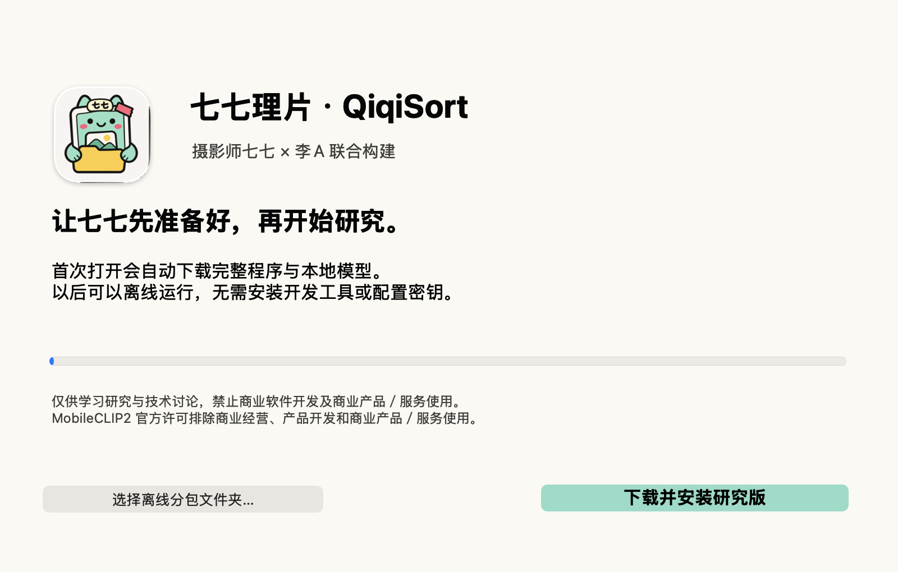

# 下载与启动

**本项目仅用于学习研究与技术讨论，禁止商业软件开发及商业产品／服务使用。**

## 三步打开

1. [下载 Mac 研究版启动器](https://github.com/limusu2333/QiqiSort/releases/latest/download/QiqiSort-Research-macOS.zip)，解压。
2. 双击“七七理片研究版.app”。首次打开后点击“下载并安装研究版”，窗口会显示下载、校验和安装进度；中断后再次打开可继续下载。无需手动合并分包或安装开发工具。
3. 安装完成后自动打开工作台。以后再双击此启动器，会直接打开已安装的七七整理台。

完整程序安装到用户的 `Applications/七七理片研究版` 文件夹。启动器下载与校验完整模型及运行资源；完成后可离线运行。首装下载约 3 GB，建议至少预留 12 GB 磁盘空间用于下载和解压。完成后自动移除本次安装临时文件。

需要 Apple 芯片（M 系列）的 Mac，macOS 14 或以上。当前验收机器为 M2 Ultra、64 GB 内存。

## macOS 首次打开提示

研究版使用本地签名，尚未完成 Apple 公证。若系统首次拦截，尝试打开后，到“系统设置 → 隐私与安全性”，找到该应用并选择“仍要打开”。解压后的应用若位于只读磁盘，请先复制到本机。无需关闭系统安全检查，也不需要终端命令。

[Apple 官方打开被拦截应用的说明](https://support.apple.com/zh-cn/102445)。

## 首次安装没有网络

可在有网的电脑上下载同一 Release 的启动器 ZIP 与全部 `QiqiSort-Research-data.zip.*` 数据分包，把分包放在启动器旁边。启动器会自动识别并校验这些本地分包。若未自动找到，点击“选择离线分包文件夹…”选择它们所在的目录。无需手动合并。

## 开始研究

导入属于同一场婚礼的照片，选择“整理照片”或“只挑合影”，先用少量素材熟悉复核、纠正、暂停和导出。只使用你有权用于研究的照片。原片不移动、不删除。正式研究前请先阅读 [用途与模型许可](发布范围.md)。

## 学习数据

每个安装副本从空白用户记录开始。你在研究过程中产生的分类反馈保存在安装文件夹的 `原项目/data/learning/`，不会上传 GitHub。任务与照片仍保存在你选择的位置。更换安装目录前，请保留自己生成的学习记录与任务。
